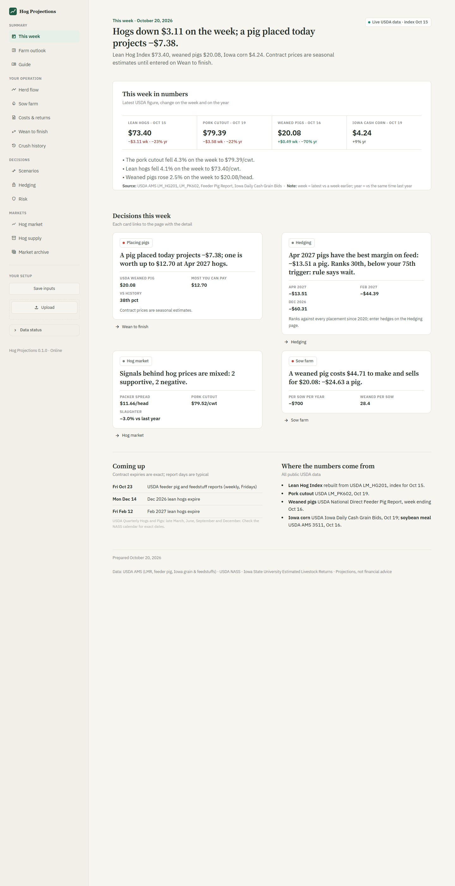

# Hog Projections

Farrow-to-finish projections for hog producers and their advisors: how many pigs you'll sell
and when, what they cost to raise, today's hog market, and the odds of making money. It runs
in your web browser on your own computer.



**What it answers**

| Page | Question |
|---|---|
| Overview | Are we making money at today's prices, and what moves it most? One-click Excel report. |
| Herd flow | How many pigs reach market each week, and when does a herd change show up? |
| Costs & returns | What's our breakeven and cost per pig (Iowa State ELR format)? |
| Wean to finish | What does a weaned pig bought at the USDA price make when sold ~160 days later, what's the most we can pay for one, and how are the pigs already on feed doing? |
| Scenarios | What would expanding, cheaper feed or better productivity do? |
| Risk | What's the chance of a profit next year, and what would a price floor (LRP) do? |
| Market prices | Where is the Lean Hog Index, and what's the seasonal pattern? |

Hog prices come live from USDA (no account needed). Costs reproduce Iowa State University's
Estimated Livestock Returns to the cent. See [`docs/PLAN.md`](docs/PLAN.md) for what's next.

## Quick start (no programming needed)

1. **Get the code.** Either
   - click the green **Code → Download ZIP** button on GitHub and unzip it, or
   - run `git clone https://github.com/calebsmit/HogProjections-.git`
2. **Start the app** by double-clicking the launcher for your computer:

   | Computer | Double-click |
   |---|---|
   | Windows | `run.bat` |
   | Mac | `run.command` (first time: right-click → **Open** → **Open**) |
   | Linux | `./run.sh` in a terminal |

3. Your browser opens at <http://localhost:8501>. To stop the app, close the black terminal window.

The first launch takes a minute or two. It downloads [uv](https://docs.astral.sh/uv/), the
right version of Python and the app's libraries into the project folder. It doesn't change
anything else on your computer. Later launches take a few seconds.

## Optional: live USDA data

**Hog prices need no key.** When you're online the app pulls the daily USDA hog report and
rebuilds the CME Lean Hog Index itself. Offline, it uses the last data it saved, or the sample
data that ships with the app.

Two free keys unlock more data (planned features). Paste them into the `.env` file in this
folder, after the `=` sign, with no spaces or quotes. The launcher creates `.env` the first
time it runs. Never share the keys or commit `.env`.

| Key | Unlocks | Where to get it (free) |
|---|---|---|
| `USDA_MMN_API_KEY` | Corn and soybean meal prices (USDA My Market News) | <https://mymarketnews.ams.usda.gov/mymarketnews-api> |
| `NASS_API_KEY` | Hog supply page: quarterly Hogs & Pigs inventory, supply outlook, U.S. pigs-per-litter benchmark, Iowa corn prices (works offline from bundled data without a key) | <https://quickstats.nass.usda.gov/api> |

Optional: add `PREPARED_BY=Your Name` to `.env` to sign the page footer and the Excel report.

## Troubleshooting

- **Mac says the file "can't be opened":** right-click `run.command` → **Open**. If you
  downloaded a ZIP, you may need to run `xattr -d com.apple.quarantine run.command` in Terminal.
- **Windows SmartScreen warning:** click **More info → Run anyway**.
- **Port already in use:** another copy is already running. Close it, or open
  <http://localhost:8501>.

---

## For developers

```bash
uv sync                      # install deps (incl. dev tools)
uv run streamlit run app.py  # run the app
uv run pytest                # tests
uv run ruff check . && uv run ruff format --check . && uv run pyright
```

Project docs (the source of truth for the build):

| Doc | Purpose |
|---|---|
| [`CLAUDE.md`](CLAUDE.md) | Working rules for AI agents and humans, plus the lessons log |
| [`docs/PRD.md`](docs/PRD.md) | What we're building and why |
| [`docs/DESIGN.md`](docs/DESIGN.md) | Design system: tokens, type, components, chart rules |
| [`docs/ARCHITECTURE.md`](docs/ARCHITECTURE.md) | Code map, data flow, invariants |
| [`docs/PLAN.md`](docs/PLAN.md) | Phased plan with verification checks |
| [`docs/PROGRESS.md`](docs/PROGRESS.md) | Session-by-session log |
| [`docs/research/`](docs/research/) | Domain and tooling research |
| [`docs/decisions/`](docs/decisions/) | Architecture decision records |
