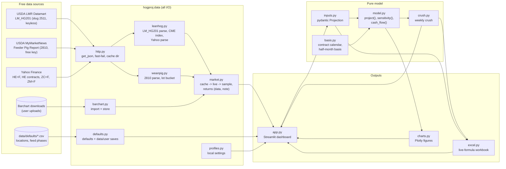

# Architecture

> Source of truth for code structure: a code map, the data flow and the invariants. Update it in
> the same commit as any structural change, and log the change in the Changelog.

## Bird's-eye view

## Code map

| Path | Role |
|---|---|
| `app.py` | Streamlit UI. Builds a `Projection` from widgets, calls `project()`, renders the tabs. No business math. |
| `src/hogproj/inputs.py` | `Projection`, `Location`, `FeedPhase`, `MarketingCut`, enums. Units are in field names. List limits match the Excel slots. |
| `src/hogproj/model.py` | `project(p) -> Result` (summary dict, costs/feed/marketing DataFrames), `sensitivity()` and `cash_flow()` (monthly; reconciles to `project`). Pure. |
| `src/hogproj/basis.py` | Lean hog contract calendar (`lean_hog_contract_for`, `lean_hog_expiry`, `in_roll_gap`) and half-month basis aggregation. Pure. |
| `src/hogproj/excel.py` | `build_workbook()`. Every number is a formula over named input cells, so the workbook mirrors `model.py`. Sheets: How to use, Dashboard (KPI tiles, verdict, P&L, what-if grid), Inputs, Locations, Feed, Marketing, Market Data, Costs, Weekly Crush. Results are named cells (`KpiNet`, `SensGrid`, `Cost*`), which the tests read. |
| `src/hogproj/crush.py` | Weekly crush: `Week`, `crush_table()` (one `project()` per week, single sale), `build_weeks()` (as-of prices from history; weeks after today use today's prices; fallbacks and stale prices noted), `CrushSpec` for Excel. Pure. |
| `src/hogproj/tables.py` | Edited dashboard tables → validated models, with plain-English problems; blank basis = 0; missing futures contracts filled from the nearest one (flagged). Pure. |
| `src/hogproj/charts.py` | Plotly figure builders (dataviz reference palette). Transparent, so the dashboard card is the surface. Pure. |
| `src/hogproj/ui.py` | HTML for the dashboard (header, KPI cards, hero verdict, notices, stat lists, the crush sheet) rendered with `st.html`. Escapes all user text. Pure. |
| `src/hogproj/ui.css` | Design tokens, cards (`st.container(key="card_…")`), tabs and motion. Loaded once by `app.py`. |
| `.streamlit/config.toml`, `static/fonts/` | Theme (colors, radius, Inter font) and the bundled Inter font (OFL), served locally so the look works offline. |
| `src/hogproj/data/http.py` | The only module that opens sockets. Retries 5xx only; transport errors raise `FetchError(unreachable=True)`. |
| `src/hogproj/data/leanhog.py` | LM_HG201 → CME Lean Hog Index (with coverage check); Yahoo chart parsing; futures curve. |
| `src/hogproj/data/weanpig.py` | USDA 2810 parsing (keyword field matching) and the lot-bucket choice. |
| `src/hogproj/data/market.py` | Loaders returning `Loaded(data, note, live)`. Order: cache → live → sample. |
| `src/hogproj/data/barchart.py` | Barchart CSV/XLSX import (website + Barchart-for-Excel layouts), series guessing, storage in `data/cache/barchart/` (never committed). |
| `src/hogproj/data/profiles.py` | Named settings profiles saved as JSON in `data/user/profiles/` (gitignored). |
| `src/hogproj/data/defaults.py` | Default projection and locations. User-saved locations live in `data/user/` (gitignored). |
| `data/defaults/` | Committed CSVs: `locations.csv` (with source notes), `feed_phases.csv`. |
| `data/cache/`, `data/user/` | Runtime only; gitignored. |
| `tests/` | Unit tests for each module, Excel/model parity via LibreOffice, app smoke tests (offline). |

## Invariants

1. **Layering.** `inputs`, `model`, `basis` and `charts` never import `streamlit`, `httpx` or `hogproj.data`. Only `data/http.py` does network I/O.
2. **Excel = model.** Every cost, revenue and summary formula in `excel.py` mirrors `model.py`. `tests/test_excel.py` recalculates real workbooks and compares to 1e-9 (including the what-if grid against `model.sensitivity`). Change both, or neither. Read results by name, never by cell address.
3. **One contract rule everywhere.** `lean_hog_contract_for` decides which futures contract prices a sale date. The historical basis drops roll-gap days so it is measured against that same contract. The Excel formula implements the same rule.
4. **Units in names.** `_usd_bu`, `_usd_ton`, `_cwt` (carcass unless it says `live`), `_lb`, `_pct`.
5. **Offline first.** With `OFFLINE=true` and no network, every page renders from defaults. Every loader returns a human-readable `note` that the UI shows.
6. **No silent changes to user input.** Partly blank rows are reported, never dropped. Editor
   outputs are never fed back as editor inputs (see the app.py docstring). Models reject NaN.
7. **No company figures in git.** Defaults are generic. Company numbers live only in local
   profiles (`data/user/`) and imports (`data/cache/`); tests use synthetic numbers.
8. **The crush can't disagree with the projection.** Every crush column is `model.project()`
   with the group's settings (minus hedges, which belong to one group's sales), and the Excel
   crush formulas are parity-tested against `crush_table`.
9. **No silent truncation.** Input list sizes are capped by the pydantic models to the workbook's row slots. `build_workbook` raises if the locations or contracts exceed their slots.
10. **One look.** Colors, type and spacing come from `config.toml` + `ui.css` tokens; app text
   goes through `ui.py` builders (`st.html`, no `$…$` LaTeX risk) or Streamlit widgets. No emoji
   in labels; icons are Material (`:material/…:`). Motion is short, eased, and off under
   `prefers-reduced-motion`.

## Changelog
- 2026-10-17: Initial scaffold and proposed target design.
- 2026-10-18: Replaced the generic herd/finance/markets/risk plan with the W2F group design
  above (`inputs`/`model`/`basis`/`excel`/`charts` + `data/*`). Monte Carlo and the herd
  simulator are dropped from scope (PRD non-goals). See ADR 0002.
- 2026-10-18: Added `model.cash_flow` and `charts.cash_flow_chart`.
- 2026-10-18: Added `tables.py` and the editor-state rule after the second review.
- 2026-10-19: Phase 7: `crush.py`, `data/barchart.py`, `data/profiles.py`; Weekly crush and Data
  tabs; Excel Weekly Crush sheet; invariants 7–8.
- 2026-10-19: Third review: crush drops hedges; Barchart contract basis overlays the base history
  instead of replacing it; corn cash vs futures imports are separate kinds.
- 2026-10-19: UI pass: `ui.py`/`ui.css`, theme + bundled Inter, card layout, HTML crush sheet,
  Excel built on click, cached comparison/sensitivity runs; invariant 10.
- 2026-10-19: Workbook redesign (How to use sheet, Dashboard P&L + what-if grid, named result
  cells); dashboard adds a P&L statement, plain-English summary, crush KPIs, ranking, Guide tab.
