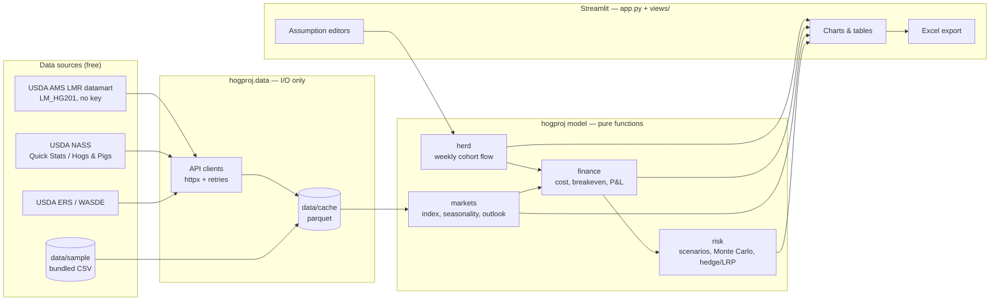

# Architecture

> Source of truth for code structure. Short on purpose (matklad style): a code map, the data
> flow and the invariants. Update it in the same commit as any structural change, and log it
> in the Changelog.
> **Current state:** Phases 2–3 (herd flow, costs & returns) built. The "Target" sections are the proposed design until the
> PRD is finalized.

## Bird's-eye view

## Code map

| Path | Role | Status |
|---|---|---|
| `app.py` | Router (`st.navigation`) + home page; keeps widget state across pages | done |
| `views/` | One file per page. Not `pages/`: that name triggers Streamlit's legacy auto-nav | started |
| `src/hogproj/config.py` | Paths + `Settings` (env / `.env`) | done |
| `src/hogproj/data/ams.py` | Keyless LMR datamart client (LM_HG201); live → `data/cache` → `data/sample` | done |
| `src/hogproj/herd.py` | Weekly cohort herd flow; pipeline starts in steady state | done |
| `src/hogproj/finance.py` | ISU ELR line-item cost per pig, breakeven, sensitivity, weekly returns | done |
| `src/hogproj/data/nass.py` | NASS Quick Stats client (Hogs and Pigs + Iowa corn price received); key never logged; live → cache → sample | done |
| `src/hogproj/data/feeder.py` | USDA National Direct Feeder Pig Report (AMS_2810) public PDF parser; weekly early weaned cash composite; sample (Oct 2020 on) + cache keep history | done |
| `src/hogproj/crush.py` | Wean-to-finish margin: CME contract mapping (10th business day expiry), breakevens, margin by placement week (sold at index / on feed at futures) | done |
| `src/hogproj/data/lmr.py` | Generic incremental LMR loader (spec: slug, section, fields); pork cutout LM_PK602 since 2020 | done |
| `src/hogproj/data/feed.py` | Public AMS PDFs: Iowa cash corn + CBOT corn (2850), Iowa SBM and DDGS (3511); history accumulates in cache | done |
| `src/hogproj/hogmarket.py` | Daily/weekly market table (index, cutout, packer spread, slaughter, weights), year-ago comparisons, rule-based signals | done |
| `src/hogproj/book.py` | Hedging book: positions on feed, hog/corn/SBM hedges, locked vs open, exposure, what-if, user hedge rule | done |
| `src/hogproj/sowfarm.py` | Farrow-to-wean cost per weaned pig (ISU Sep 2026 calibration), sow margin history, integrated sow + finishing | done |
| `src/hogproj/brief.py` | Weekly moves, movers in words, calendar of contract expiries and report days | done |
| `src/hogproj/archive.py` | Weekly record since 2020 joining every series; yearly averages | done |
| `scripts/screenshots.py` | Every page at 1440 and 390 px via Playwright (installed Edge/Chrome) for phase reviews | done |
| `src/hogproj/supply.py` | Forward supply outlook from weight classes, pig crop and farrowing intentions | done |
| `src/hogproj/markets.py` | Lean Hog Index from HG201, monthly seasonal factors | done |
| `src/hogproj/outlook.py` | Whole-farm `Plan` (herd + cost + price path): projection, 12-month summary, monthly rollup, profit drivers | done |
| `src/hogproj/ui.py` | Design system (tokens, CSS, Plotly template, components) + cached data load and number formatting; see `docs/DESIGN.md` | done |
| `assets/` | Logo and favicon SVGs | done |
| `src/hogproj/risk.py` | Monte Carlo profit (fitted hog AR(1) + corn walk), price-floor payoff | done |
| `src/hogproj/export.py` | Excel report builder (xlsxwriter, returns bytes) | done |
| `data/sample/` | Committed datasets so the app runs offline (3 years of HG201, ~240 KB) | started |
| `tests/` | pytest. `test_smoke.py` renders the app headless | started |
| `run.bat`, `run.command`, `run.sh` | Recipient launchers | done |

## Invariants

- **Layering:** UI → model → (nothing); UI → data → network/disk. Model modules never import
  `streamlit`, `httpx` or `data`.
- Model functions are deterministic given their inputs. Randomness takes an explicit `seed`.
- Every quantity carries its unit in its name. Prices are $/cwt and state `live` or `carcass`.
- The app starts and every page renders with `OFFLINE=true` and no `.env`.
- Inputs cross into the model as pydantic models. Results come back as pandas DataFrames.
- Inputs live in widget keys (`herd_*`, `cost_*`, `scn_*`, `risk_*`, `mkt_*`). `ui.current_plan()`
  builds the herd and cost models from those keys, so every page (and a loaded setup file)
  agrees even if the page owning a widget was never opened. Save/Load in `app.py` round-trips
  exactly those keys.
- `outlook.synced()` copies herd facts (weight, yield, pigs sold per sow) into the cost model;
  always project through it so the two pages can't disagree.

## Changelog
- 2026-10-17: Initial scaffold and proposed target design.
- 2026-10-19: Design system (ADR 0002, `docs/DESIGN.md`): theme tokens, `ui.py` components,
  Material-icon navigation, `assets/` logo.
- 2026-10-19: Added `data/ams.py`, `markets.py`, `ui.py` and the Market prices page. Tests
  force `OFFLINE=true` (tests/conftest.py).
- 2026-10-19: Added herd/finance modules and two pages; pages live in `views/` behind an
  `st.navigation` router in `app.py` (so the sidebar says "Home", not "app").
