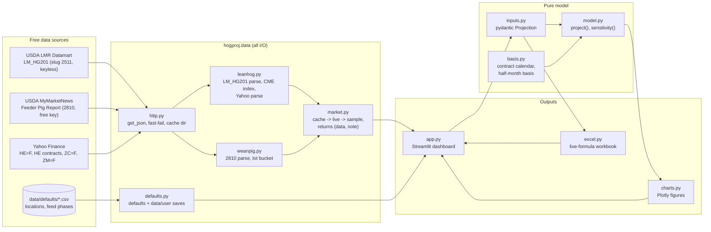

# Architecture

> Source of truth for code structure: a code map, the data flow and the invariants. Update it in
> the same commit as any structural change, and log the change in the Changelog.

## Bird's-eye view

## Code map

| Path | Role |
|---|---|
| `app.py` | Streamlit UI. Builds a `Projection` from widgets, calls `project()`, renders the tabs. No business math. |
| `src/hogproj/inputs.py` | `Projection`, `Location`, `FeedPhase`, `MarketingCut`, enums. Units are in field names. List limits match the Excel slots. |
| `src/hogproj/model.py` | `project(p) -> Result` (summary dict, costs/feed/marketing DataFrames) and `sensitivity()`. Pure. |
| `src/hogproj/basis.py` | Lean hog contract calendar (`lean_hog_contract_for`, `lean_hog_expiry`, `in_roll_gap`) and half-month basis aggregation. Pure. |
| `src/hogproj/excel.py` | `build_workbook()`. Every number is a formula over named input cells, so the workbook mirrors `model.py`. |
| `src/hogproj/charts.py` | Plotly figure builders (dataviz reference palette). Pure. |
| `src/hogproj/data/http.py` | The only module that opens sockets. Retries 5xx only; transport errors raise `FetchError(unreachable=True)`. |
| `src/hogproj/data/leanhog.py` | LM_HG201 → CME Lean Hog Index (with coverage check); Yahoo chart parsing; futures curve. |
| `src/hogproj/data/weanpig.py` | USDA 2810 parsing (keyword field matching) and the lot-bucket choice. |
| `src/hogproj/data/market.py` | Loaders returning `Loaded(data, note, live)`. Order: cache → live → sample. |
| `src/hogproj/data/defaults.py` | Default projection and locations. User-saved locations live in `data/user/` (gitignored). |
| `data/defaults/` | Committed CSVs: `locations.csv` (with source notes), `feed_phases.csv`. |
| `data/cache/`, `data/user/` | Runtime only; gitignored. |
| `tests/` | Unit tests for each module, Excel/model parity via LibreOffice, app smoke tests (offline). |

## Invariants

1. **Layering.** `inputs`, `model`, `basis` and `charts` never import `streamlit`, `httpx` or `hogproj.data`. Only `data/http.py` does network I/O.
2. **Excel = model.** Every cost, revenue and summary formula in `excel.py` mirrors `model.py`. `tests/test_excel.py` recalculates real workbooks and compares to 1e-9. Change both, or neither.
3. **One contract rule everywhere.** `lean_hog_contract_for` decides which futures contract prices a sale date. The historical basis drops roll-gap days so it is measured against that same contract. The Excel formula implements the same rule.
4. **Units in names.** `_usd_bu`, `_usd_ton`, `_cwt` (carcass unless it says `live`), `_lb`, `_pct`.
5. **Offline first.** With `OFFLINE=true` and no network, every page renders from defaults. Every loader returns a human-readable `note` that the UI shows.
6. **No silent truncation.** Input list sizes are capped by the pydantic models to the workbook's row slots. `build_workbook` raises if the locations or contracts exceed their slots.

## Changelog
- 2026-10-17: Initial scaffold and proposed target design.
- 2026-10-18: Replaced the generic herd/finance/markets/risk plan with the W2F group design
  above (`inputs`/`model`/`basis`/`excel`/`charts` + `data/*`). Monte Carlo and the herd
  simulator are dropped from scope (PRD non-goals). See ADR 0002.
