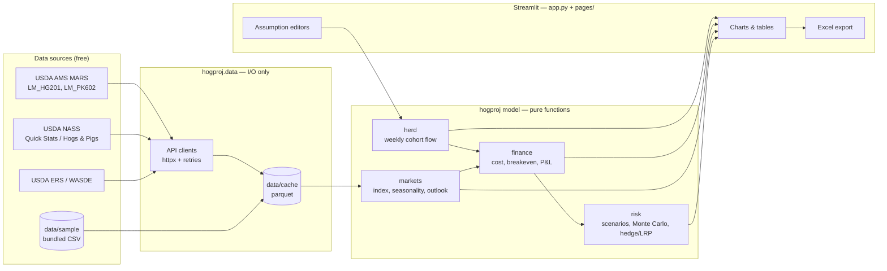

# Architecture

> Source of truth for code structure. Short on purpose (matklad style): a code map, the data
> flow and the invariants. Update it in the same commit as any structural change, and log it
> in the Changelog.
> **Current state:** Phase 0 scaffold. The "Target" sections are the proposed design until the
> PRD is finalized.

## Bird's-eye view

## Code map

| Path | Role | Status |
|---|---|---|
| `app.py` | Streamlit entry / home page | scaffold |
| `pages/` | One file per Streamlit page | planned |
| `src/hogproj/config.py` | Paths + `Settings` (env / `.env`) | done |
| `src/hogproj/data/` | API clients, cache, sample loader. The only package allowed to touch the network or disk | planned |
| `src/hogproj/herd.py` | Herd-flow simulation | planned |
| `src/hogproj/finance.py` | Cost of production, breakeven, P&L | planned |
| `src/hogproj/markets.py` | Price series, Lean Hog Index calc, seasonality | planned |
| `src/hogproj/risk.py` | Scenarios, Monte Carlo, hedge/LRP payoffs | planned |
| `src/hogproj/export.py` | Excel workbook builder | planned |
| `data/sample/` | Small committed datasets so the app runs offline | planned |
| `tests/` | pytest. `test_smoke.py` renders the app headless | started |
| `run.bat`, `run.command`, `run.sh` | Recipient launchers | done |

## Invariants

- **Layering:** UI → model → (nothing); UI → data → network/disk. Model modules never import
  `streamlit`, `httpx` or `data`.
- Model functions are deterministic given their inputs. Randomness takes an explicit `seed`.
- Every quantity carries its unit in its name. Prices are $/cwt and state `live` or `carcass`.
- The app starts and every page renders with `OFFLINE=true` and no `.env`.
- Inputs cross into the model as pydantic models. Results come back as pandas DataFrames.

## Changelog
- 2026-10-17: Initial scaffold and proposed target design.
